# Laporan Mid-Project Jaringan Komputer
### Implementasi Jaringan Smart City Kota Surabaya
### Komunikasi Data & Jaringan Komputer 2026/2027

**Kelompok:** K-12
**Base IP Kelompok:** `10.96.0.0/16`
**Skema yang dipakai:** VLSM
**Domain internal:** `k12.smartcity.lab`
**Tools:** Cisco Packet Tracer 9.0.1

>Maulana Zaki Putra Zakaria | 5027251009

>Nama Anggota B | NRP

>Nama Anggota C | NRP

---

## Daftar Isi
- [Ringkasan Topologi & Tabel Pengalamatan IP](#ringkasan-topologi--tabel-pengalamatan-ip)
  - [Alasan Memilih VLSM](#alasan-memilih-vlsm)
  - [Tabel VLSM](#tabel-vlsm)
  - [Link Backbone & Alamat Tambahan](#link-backbone--alamat-tambahan)
  - [Tabel Port Router](#tabel-port-router)
  - [Alamat Statis](#alamat-statis)
- [Panduan Dasar Packet Tracer](#panduan-dasar-packet-tracer)
- [Soal 1 – Perancangan Topologi](#soal-1)
- [Soal 2 – Tabel Subnetting](#soal-2)
- [Soal 3 – Static Routing](#soal-3)
- [Soal 4 – DHCP](#soal-4)
- [Soal 5 – NAT](#soal-5)
- [Soal 6 – Tunnel GRE](#soal-6)
- [Soal 7 – Dynamic Routing OSPF](#soal-7)
- [Soal 8 – Layanan Aplikasi Smart City](#soal-8)
- [Kendala & Solusi](#kendala--solusi)

---

## Ringkasan Topologi & Tabel Pengalamatan IP

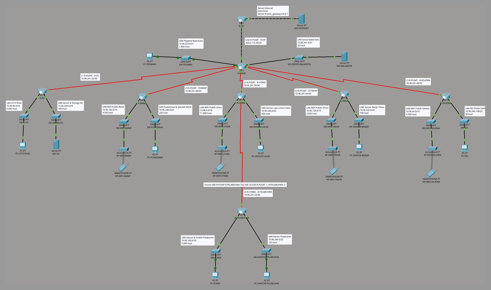
*Topologi lengkap K12: R-ISP dan SRV-INTERNET di atas, R-PUSAT (Balai Kota) di tengah, lima router wilayah di bawahnya, dan R-PELABUHAN di bawah R-UTARA. Garis merah = link serial backbone L1–L6, garis hitam putus-putus = link tembaga ke ISP, setiap LAN diberi label nama subnet, network ID/prefix, dan jumlah host.*

### Alasan Memilih VLSM

Kebutuhan seluruh LAN dan link adalah **61.752 alamat**, yaitu **94,2%** dari blok `10.96.0.0/16` (65.536 alamat). Ruang sisa hanya 3.784 alamat.

- **VLSM** (urut dari kebutuhan host terbesar) memberi setiap subnet blok terkecil yang cukup, sehingga semuanya muat di dalam `/16`.
- **CIDR berbasis topologi** (setiap router bisa diringkas menjadi satu supernet) **tidak muat** di `/16`. Contoh: R-DC, R-BARAT, R-TIMUR, R-SELATAN, dan R-PELABUHAN masing-masing punya satu LAN `/19` ditambah LAN kecil, jadi supernet tiap router minimal `/18` (16.384 alamat). Lima router × `/18` = 81.920 alamat, sudah lebih besar dari `/16`, belum termasuk sisi R-UTARA yang berisi WiFi Utara `/18`.

Karena itu file Packet Tracer dibangun dengan skema **VLSM**. Tabel CIDR tetap dibuat di spreadsheet (soal 2) sesuai lembar UTS.

### Tabel VLSM

Diurutkan dari kebutuhan host terbesar. Gateway setiap LAN = host pertama.

| Subnet | Router | Kebutuhan Host | Network ID | Prefix | Subnet Mask | Range Host | Broadcast | Gateway | Kapasitas |
| :--- | :--- | ---: | :--- | :---: | :--- | :--- | :--- | :--- | ---: |
| WiFi Publik Utara | R-UTARA | 11.000 | `10.96.0.0` | /18 | `255.255.192.0` | `10.96.0.1` – `10.96.63.254` | `10.96.63.255` | `10.96.0.1` | 16.382 |
| WiFi Publik Selatan | R-SELATAN | 6.500 | `10.96.64.0` | /19 | `255.255.224.0` | `10.96.64.1` – `10.96.95.254` | `10.96.95.255` | `10.96.64.1` | 8.190 |
| CCTV Kota | R-DC | 6.000 | `10.96.96.0` | /19 | `255.255.224.0` | `10.96.96.1` – `10.96.127.254` | `10.96.127.255` | `10.96.96.1` | 8.190 |
| WiFi Publik Timur | R-TIMUR | 5.500 | `10.96.128.0` | /19 | `255.255.224.0` | `10.96.128.1` – `10.96.159.254` | `10.96.159.255` | `10.96.128.1` | 8.190 |
| Sensor & SCADA Pelabuhan | R-PELABUHAN | 5.000 | `10.96.160.0` | /19 | `255.255.224.0` | `10.96.160.1` – `10.96.191.254` | `10.96.191.255` | `10.96.160.1` | 8.190 |
| WiFi Publik Barat | R-BARAT | 4.500 | `10.96.192.0` | /19 | `255.255.224.0` | `10.96.192.1` – `10.96.223.254` | `10.96.223.255` | `10.96.192.1` | 8.190 |
| Pegawai Balai Kota | R-PUSAT | 1.800 | `10.96.224.0` | /21 | `255.255.248.0` | `10.96.224.1` – `10.96.231.254` | `10.96.231.255` | `10.96.224.1` | 2.046 |
| Sensor Banjir Timur | R-TIMUR | 700 | `10.96.232.0` | /22 | `255.255.252.0` | `10.96.232.1` – `10.96.235.254` | `10.96.235.255` | `10.96.232.1` | 1.022 |
| Sensor Lalu Lintas Utara | R-UTARA | 450 | `10.96.236.0` | /23 | `255.255.254.0` | `10.96.236.1` – `10.96.237.254` | `10.96.237.255` | `10.96.236.1` | 510 |
| Puskesmas & Sekolah Barat | R-BARAT | 220 | `10.96.238.0` | /24 | `255.255.255.0` | `10.96.238.1` – `10.96.238.254` | `10.96.238.255` | `10.96.238.1` | 254 |
| Server & Storage DC | R-DC | 180 | `10.96.239.0` | /24 | `255.255.255.0` | `10.96.239.1` – `10.96.239.254` | `10.96.239.255` | `10.96.239.1` | 254 |
| Kantor Pelabuhan | R-PELABUHAN | 120 | `10.96.240.0` | /25 | `255.255.255.128` | `10.96.240.1` – `10.96.240.126` | `10.96.240.127` | `10.96.240.1` | 126 |
| PJU Pintar Selatan | R-SELATAN | 90 | `10.96.240.128` | /25 | `255.255.255.128` | `10.96.240.129` – `10.96.240.254` | `10.96.240.255` | `10.96.240.129` | 126 |
| Server Balai Kota | R-PUSAT | 20 | `10.96.241.0` | /27 | `255.255.255.224` | `10.96.241.1` – `10.96.241.30` | `10.96.241.31` | `10.96.241.1` | 30 |

### Link Backbone & Alamat Tambahan

Link antar-router memakai `/30`. Konvensi: **router atas = host pertama, router bawah = host kedua**.

| Link | Pasangan | Network | Router Atas | Router Bawah | Broadcast |
| :--- | :--- | :--- | :--- | :--- | :--- |
| L1 | R-PUSAT – R-DC | `10.96.241.32/30` | `10.96.241.33` | `10.96.241.34` | `10.96.241.35` |
| L2 | R-PUSAT – R-UTARA | `10.96.241.36/30` | `10.96.241.37` | `10.96.241.38` | `10.96.241.39` |
| L3 | R-PUSAT – R-SELATAN | `10.96.241.40/30` | `10.96.241.41` | `10.96.241.42` | `10.96.241.43` |
| L4 | R-PUSAT – R-TIMUR | `10.96.241.44/30` | `10.96.241.45` | `10.96.241.46` | `10.96.241.47` |
| L5 | R-PUSAT – R-BARAT | `10.96.241.48/30` | `10.96.241.49` | `10.96.241.50` | `10.96.241.51` |
| L6 | R-UTARA – R-PELABUHAN | `10.96.241.52/30` | `10.96.241.53` | `10.96.241.54` | `10.96.241.55` |

Alamat yang diberikan soal (K = 12, tidak dihitung saat UTS):

| Keperluan | Alamat |
| :--- | :--- |
| Link R-PUSAT – R-ISP | `203.0.113.48/30` (4 × 12 = 48) → R-ISP `.49`, R-PUSAT `.50` |
| Server internet | `8.8.8.0/24` → SRV-INTERNET `8.8.8.8`, gateway `8.8.8.1` di R-ISP |
| Tunnel GRE | `192.168.12.0/30` → R-PUSAT `.1`, R-PELABUHAN `.2` |

Alamat terakhir yang terpakai adalah `10.96.241.55`. Link cadangan L7 untuk file OSPF memakai `10.96.241.56/30`.

### Tabel Port Router

Semua router **Cisco 2911**. R-PUSAT dipasangi 3 modul **HWIC-2T** (slot 0/0, 0/1, 0/2), router lain 1 modul HWIC-2T (slot 0/0), R-ISP tanpa modul. Ujung **DCE** serial selalu di router atas.

| Router | Port | Terhubung ke | IP Address |
| :--- | :--- | :--- | :--- |
| R-ISP | G0/0 | R-PUSAT G0/0 (cross-over) | `203.0.113.49/30` |
| | G0/1 | SRV-INTERNET (cross-over) | `8.8.8.1/24` |
| R-PUSAT | G0/0 | R-ISP G0/0 | `203.0.113.50/30` |
| | G0/1 | SW-PEGAWAI G0/1 | `10.96.224.1/21` |
| | G0/2 | SW-SERVER-BALAIKOTA G0/1 | `10.96.241.1/27` |
| | S0/0/0 (DCE) | L1 → R-DC S0/0/0 | `10.96.241.33/30` |
| | S0/0/1 (DCE) | L2 → R-UTARA S0/0/0 | `10.96.241.37/30` |
| | S0/1/0 (DCE) | L3 → R-SELATAN S0/0/0 | `10.96.241.41/30` |
| | S0/1/1 (DCE) | L4 → R-TIMUR S0/0/0 | `10.96.241.45/30` |
| | S0/2/0 (DCE) | L5 → R-BARAT S0/0/0 | `10.96.241.49/30` |
| | S0/2/1 | cadangan (shutdown) | — |
| R-DC | S0/0/0 | L1 → R-PUSAT | `10.96.241.34/30` |
| | G0/0 | SW-CCTV G0/1 | `10.96.96.1/19` |
| | G0/1 | SW-SERVER-DC G0/1 | `10.96.239.1/24` |
| R-UTARA | S0/0/0 | L2 → R-PUSAT | `10.96.241.38/30` |
| | S0/0/1 (DCE) | L6 → R-PELABUHAN S0/0/0 | `10.96.241.53/30` |
| | G0/0 | SW-WIFI-UTARA G0/1 | `10.96.0.1/18` |
| | G0/1 | SW-SENSOR-LALIN G0/1 | `10.96.236.1/23` |
| R-SELATAN | S0/0/0 | L3 → R-PUSAT | `10.96.241.42/30` |
| | G0/0 | SW-WIFI-SELATAN G0/1 | `10.96.64.1/19` |
| | G0/1 | SW-PJU G0/1 | `10.96.240.129/25` |
| R-TIMUR | S0/0/0 | L4 → R-PUSAT | `10.96.241.46/30` |
| | G0/0 | SW-WIFI-TIMUR G0/1 | `10.96.128.1/19` |
| | G0/1 | SW-SENSOR-BANJIR G0/1 | `10.96.232.1/22` |
| R-BARAT | S0/0/0 | L5 → R-PUSAT | `10.96.241.50/30` |
| | G0/0 | SW-WIFI-BARAT G0/1 | `10.96.192.1/19` |
| | G0/1 | SW-PUSKESMAS G0/1 | `10.96.238.1/24` |
| R-PELABUHAN | S0/0/0 | L6 → R-UTARA | `10.96.241.54/30` |
| | G0/0 | SW-SCADA G0/1 | `10.96.160.1/19` |
| | G0/1 | SW-KANTOR-PELABUHAN G0/1 | `10.96.240.1/25` |

### Alamat Statis

Di setiap LAN, alamat `.1`–`.10` dikecualikan dari DHCP: `.1` gateway router, `.2` server (jika ada), sisanya cadangan.

| Perangkat | IP | Gateway | DNS | Peran |
| :--- | :--- | :--- | :--- | :--- |
| SRV-DC | `10.96.239.2/24` | `10.96.239.1` | `10.96.239.2` | DHCP server LAN CCTV, DNS & FTP (soal 8) |
| SRV-BALAIKOTA | `10.96.241.2/27` | `10.96.241.1` | `10.96.239.2` | Web server (soal 8) |
| SRV-INTERNET | `8.8.8.8/24` | `8.8.8.1` | — | Server internet |

---

## Panduan Dasar Packet Tracer

Langkah-langkah di bawah dipakai berulang kali di semua soal, jadi dijelaskan sekali di sini.

### A. Membuka jendela perangkat

Klik ikon perangkat di kanvas (contoh ①: **R-PUSAT**). Jendela perangkat terbuka dengan tab *Physical*, *Config*, *CLI* (router) atau *Desktop* (PC/server/smartphone).

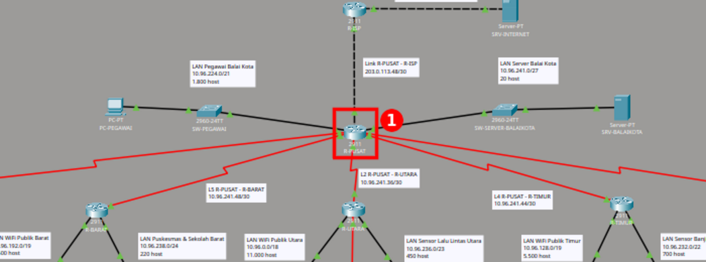

### B. Membuka CLI router

Di jendela router, klik tab ① **CLI**. Area ② adalah console IOS.
- Jika muncul `Press RETURN to get started.`, tekan **Enter**.
- Jika router baru ditanya `Would you like to enter the initial configuration dialog? [yes/no]:`, ketik `no` lalu Enter.

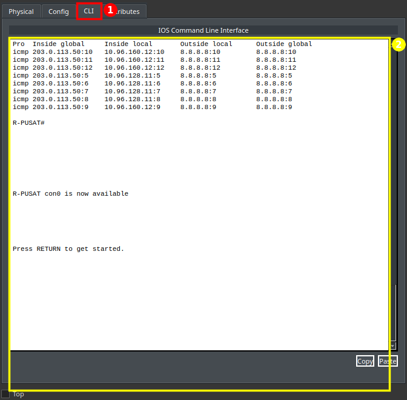

### C. Mode-mode di CLI

Perintah IOS hanya bisa diketik di mode yang tepat. Prompt menunjukkan mode yang sedang aktif.

| Prompt | Mode | Cara masuk | Dipakai untuk |
| :--- | :--- | :--- | :--- |
| `R-PUSAT>` | User EXEC | (awal) | `ping` sederhana |
| `R-PUSAT#` | Privileged EXEC | `enable` | semua perintah `show`, `copy` |
| `R-PUSAT(config)#` | Global config | `configure terminal` | `hostname`, `ip route`, `ip dhcp`, `ip nat`, `access-list` |
| `R-PUSAT(config-if)#` | Interface config | `interface <nama>` | `ip address`, `clock rate`, `no shutdown`, `ip nat inside/outside`, `ip helper-address` |
| `R-PUSAT(dhcp-config)#` | DHCP pool config | `ip dhcp pool <nama>` | `network`, `default-router`, `dns-server` |

`exit` naik satu tingkat, `end` langsung kembali ke `R-PUSAT#`.

### D. Menyimpan konfigurasi router

Setelah selesai mengetik konfigurasi, ketik:

```
end
copy running-config startup-config
```

Saat muncul `Destination filename [startup-config]?`, tekan **Enter**. Konfigurasi tersimpan bila muncul ② `[OK]`. Tanpa langkah ini, konfigurasi hilang saat router di-*reload*.

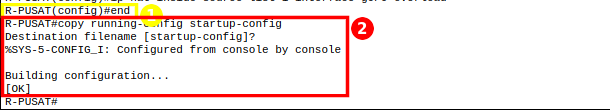

### E. Menyimpan file Packet Tracer

Tekan **Ctrl+S** atau klik ikon ① **Save** di toolbar. Lakukan setiap selesai satu tahap.


### F. Membuka Command Prompt PC / Server / Smartphone

Klik perangkat → tab ① **Desktop** → ② **Command Prompt**. (③ **IP Configuration** dipakai di soal 4.) Pada smartphone dan server, Command Prompt adalah ikon ketiga.

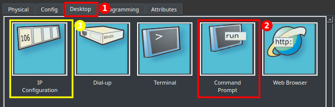

---

## Soal 1

>Dikerjakan Oleh Zaki

### Soal
> Bangun topologi di Cisco Packet Tracer sesuai skema yang dipilih (VLSM atau CIDR). Hubungan antar-router (backbone, link L1–L6), termasuk R-ISP dan server 8.8.8.8, wajib mengikuti Gambar 1. Desain setiap lokasi dirancang sendiri (susunan switch, jenis perangkat, media link, penambahan port router) beserta alasannya. Cukup pasang 1 perangkat perwakilan di setiap LAN. Ganti nama bawaan setiap perangkat dan tambahkan label di setiap LAN berisi nama subnet, Network ID/prefix, dan jumlah host.

### Langkah Pengerjaan dan Implementasi

#### Langkah 1 – Memilih perangkat (dan alasannya)

| Bagian | Perangkat | Alasan |
| :--- | :--- | :--- |
| Semua router (8) | **Cisco 2911** + modul **HWIC-2T** | Mengikuti modul praktikum (*06-Tutorial CPT*). Router-PT (IOS 12.2) **tidak punya `interface Tunnel`** dan perintah `crypto` hanya berisi `key`, sehingga GRE (soal 6) dan IPsec (bonus) mustahil. 2911 (IOS 15.1) mendukung GRE bawaan (`ipbasek9`) dan IPsec setelah lisensi `securityk9` aktif. |
| Backbone L1–L6 | Kabel **Serial DCE** | Link antarwilayah kota dimodelkan sebagai link WAN serial seperti di modul. Ujung DCE (pemberi clock) di router atas: R-PUSAT untuk L1–L5, R-UTARA untuk L6. |
| R-PUSAT | 3 × HWIC-2T + 3 port GE bawaan | Butuh 8 interface: 5 serial ke router wilayah (S0/0/0–S0/2/0, S0/2/1 cadangan), G0/0 ke ISP, G0/1 dan G0/2 ke dua LAN Balai Kota. |
| Router wilayah | 1 × HWIC-2T | S0/0/0 ke router atas, G0/0 dan G0/1 ke dua LAN. R-UTARA memakai S0/0/1 untuk L6. |
| Link ke ISP & SRV-INTERNET | Copper Cross-Over | Router–router dan router–server adalah perangkat sejenis (kelompok A). |
| Setiap LAN | 1 switch **2960-24TT** | Router → switch lewat port Gigabit `G0/1` (kabel straight). Switch membuat LAN bisa diperluas ke ribuan host sesuai kebutuhan, walau yang dipasang hanya 1 perwakilan. |
| WiFi Publik (Barat, Utara, Timur, Selatan) | **AccessPoint-PT** + **Smartphone** (wireless) | Pengguna WiFi publik adalah perangkat bergerak. Tiap AP diberi **SSID sendiri** supaya smartphone tidak tersambung ke AP wilayah lain (dengan SSID bawaan `Default`, HP-WIFI-UTARA dan HP-WIFI-SELATAN sempat tersambung ke AP-WIFI-TIMUR). |
| CCTV, Sensor Lalin, Sensor Banjir, SCADA, PJU | **PC-PT** (kabel) | Mewakili kamera/sensor/gateway IoT yang dipasang tetap dan butuh koneksi stabil, sehingga memakai kabel. |
| Pegawai, Puskesmas & Sekolah, Kantor Pelabuhan | **PC-PT** (kabel) | Komputer kerja di gedung. |
| Server Balai Kota, Server & Storage DC, Internet | **Server-PT** (IP statis) | Menjalankan layanan (Web, DNS, DHCP, FTP, email). |

#### Langkah 2 – Meletakkan router 2911 dan memasang modul HWIC-2T

1. Klik **Network Devices → Routers → 2911**, seret ke workspace. Ulangi sampai ada 8 router.
2. Klik router → tab **Physical**.
3. ① Klik tombol power sampai lampu hijau padam (modul hanya bisa dipasang saat router mati).
4. ② Klik **HWIC-2T** di daftar MODULES, lalu seret ke slot kosong ③ di panel belakang.
5. Ulangi: **R-PUSAT 3 modul**, router wilayah 1 modul, R-ISP tidak perlu.
6. Klik tombol power lagi untuk menyalakan router.

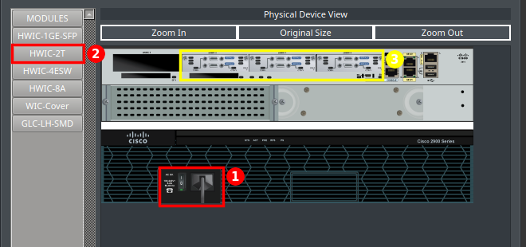
*① tombol power, ② modul HWIC-2T, ③ tiga slot HWIC di R-PUSAT yang sudah terisi (menghasilkan Serial0/0/0 sampai Serial0/2/1).*

#### Langkah 3 – Memasang kabel

1. Klik ① **Connections** (ikon petir) di kiri bawah.
2. Pilih kabel. Nama kabel muncul di bawah daftar saat kursor diarahkan ke ikonnya:
   - ② **Serial DCE** (petir merah berjam) → untuk L1–L6. **Klik router atas dulu** (R-PUSAT, atau R-UTARA untuk L6) agar ujung DCE ada di router atas.
   - Kotak kuning kiri **Copper Straight-Through** → router ke switch, switch ke PC/server/AP.
   - Kotak kuning kanan **Copper Cross-Over** → R-PUSAT ↔ R-ISP dan R-ISP ↔ SRV-INTERNET.
3. Klik perangkat pertama → pilih port → klik perangkat kedua → pilih port, sesuai [Tabel Port Router](#tabel-port-router).

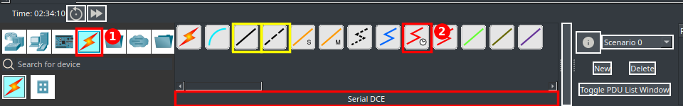

#### Langkah 4 – Mengganti nama perangkat

Klik perangkat → tab **Config** → ① **Settings** → ② ketik nama di **Display Name** (router/switch juga di **Hostname**). Nama mengikuti lokasi: `R-PUSAT`, `SW-PEGAWAI`, `PC-CCTV-KOTA`, `SRV-DC`, `AP-WIFI-BARAT`, `HP-WIFI-BARAT`, dst. Tiga *Power Distribution Device* yang dibuat otomatis oleh Packet Tracer 9 (di luar kanvas) diganti menjadi `PDU-1`–`PDU-3`.

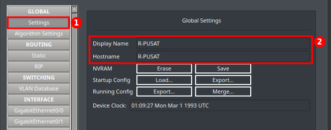

#### Langkah 5 – Konfigurasi IP R-PUSAT lewat CLI

**5.1 Buka CLI R-PUSAT.** Klik ikon **R-PUSAT** → tab **CLI** → tekan Enter (lihat [Panduan A–B](#a-membuka-jendela-perangkat)).

**5.2 Masuk mode konfigurasi dan beri nama router.** Ketik satu per satu:

```
enable
configure terminal
hostname R-PUSAT
no ip domain-lookup
```

| Perintah | Fungsi | Prompt setelahnya |
| :--- | :--- | :--- |
| `enable` | masuk mode privileged | `R-PUSAT#` |
| `configure terminal` | masuk mode konfigurasi global | `R-PUSAT(config)#` |
| `hostname R-PUSAT` | memberi nama router di CLI | `R-PUSAT(config)#` |
| `no ip domain-lookup` | mencegah CLI "macet" mencari DNS saat salah ketik | `R-PUSAT(config)#` |

**5.3 Isi IP ketiga port Gigabit.** Untuk setiap port: masuk interface → beri IP → nyalakan.

```
interface g0/0
ip address 203.0.113.50 255.255.255.252
no shutdown
interface g0/1
ip address 10.96.224.1 255.255.248.0
no shutdown
interface g0/2
ip address 10.96.241.1 255.255.255.224
no shutdown
```

| Perintah | Fungsi |
| :--- | :--- |
| `interface g0/0` | memilih port GigabitEthernet0/0 (ke R-ISP), prompt menjadi `(config-if)#` |
| `ip address 203.0.113.50 255.255.255.252` | IP publik R-PUSAT di link ISP |
| `no shutdown` | menyalakan port (port router mati secara bawaan) |
| `interface g0/1` + IP `10.96.224.1/21` | gateway LAN Pegawai Balai Kota |
| `interface g0/2` + IP `10.96.241.1/27` | gateway LAN Server Balai Kota |

Hasil di CLI:

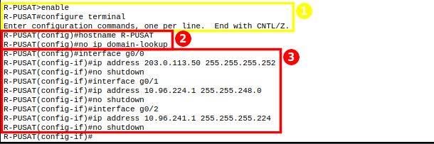
*① masuk mode konfigurasi, ② hostname dan `no ip domain-lookup`, ③ IP dan `no shutdown` ketiga port Gigabit.*

**5.4 Isi IP kelima port serial dan clock rate.** R-PUSAT adalah ujung **DCE**, jadi setiap serial diberi `clock rate 64000`.

```
interface s0/0/0
ip address 10.96.241.33 255.255.255.252
clock rate 64000
no shutdown
```

Ulangi pola yang sama untuk port lain:

| Interface | Link | IP Address |
| :--- | :--- | :--- |
| `s0/0/0` | L1 → R-DC | `10.96.241.33 255.255.255.252` |
| `s0/0/1` | L2 → R-UTARA | `10.96.241.37 255.255.255.252` |
| `s0/1/0` | L3 → R-SELATAN | `10.96.241.41 255.255.255.252` |
| `s0/1/1` | L4 → R-TIMUR | `10.96.241.45 255.255.255.252` |
| `s0/2/0` | L5 → R-BARAT | `10.96.241.49 255.255.255.252` |

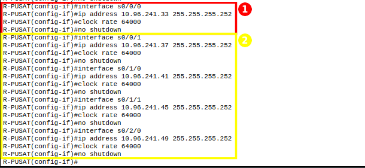
*① contoh lengkap Serial0/0/0, ② empat serial lain dengan pola yang sama.*

**5.5 Simpan.** `end` → `copy running-config startup-config` → Enter (lihat [Panduan D](#d-menyimpan-konfigurasi-router)).

> **Alternatif GUI:** tab **Config** → ① pilih interface → ② centang **Port Status On** → ③ **Clock Rate 64000** (hanya DCE) → ④ isi IPv4 Address dan Subnet Mask. Kotak ⑤ menunjukkan perintah IOS setara yang dibuat otomatis. Catatan: mengklik interface di tab Config membuat console masuk mode `(config-if)#`, jadi ketik `end` sebelum memakai perintah `show` di CLI.
>
> 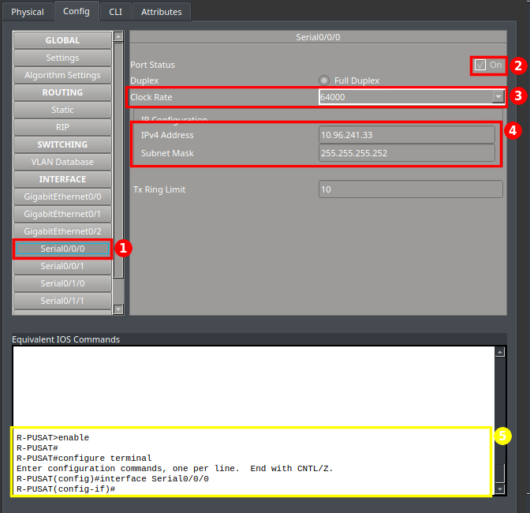

#### Langkah 6 – Konfigurasi IP R-UTARA (DCE untuk L6)

R-UTARA adalah DTE di L2 (ke R-PUSAT) tetapi **DCE di L6** (ke R-PELABUHAN), jadi hanya `s0/0/1` yang diberi `clock rate`.

Buka CLI R-UTARA, lalu ketik:

```
enable
configure terminal
hostname R-UTARA
no ip domain-lookup
interface g0/0
ip address 10.96.0.1 255.255.192.0
no shutdown
interface g0/1
ip address 10.96.236.1 255.255.254.0
no shutdown
interface s0/0/0
ip address 10.96.241.38 255.255.255.252
no shutdown
interface s0/0/1
ip address 10.96.241.53 255.255.255.252
clock rate 64000
no shutdown
```

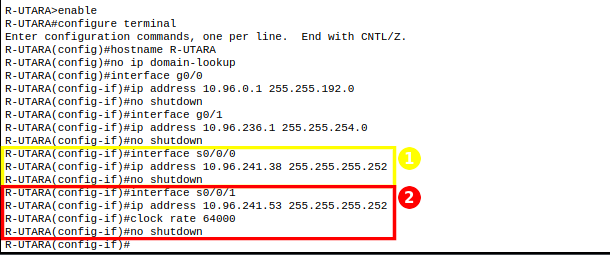
*① S0/0/0 ke R-PUSAT (DTE, tanpa clock rate), ② S0/0/1 ke R-PELABUHAN (DCE, dengan `clock rate 64000`).*

Simpan dengan `end` → `copy running-config startup-config`.

#### Langkah 7 – Konfigurasi IP router wilayah (contoh R-DC)

Router wilayah adalah sisi **DTE**, jadi tidak perlu `clock rate`. Buka CLI R-DC, lalu ketik:

```
enable
configure terminal
hostname R-DC
no ip domain-lookup
interface g0/0
ip address 10.96.96.1 255.255.224.0
no shutdown
interface g0/1
ip address 10.96.239.1 255.255.255.0
no shutdown
interface s0/0/0
ip address 10.96.241.34 255.255.255.252
no shutdown
```

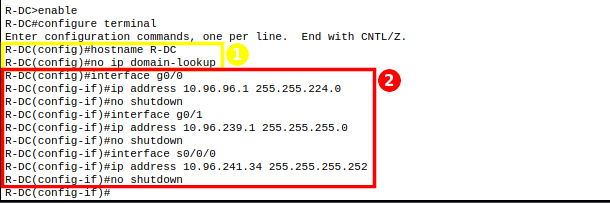
*① hostname dan `no ip domain-lookup`, ② IP ketiga interface.*

Router wilayah lain memakai pola yang sama dengan nilai berikut:

| Router | `interface g0/0` | `interface g0/1` | `interface s0/0/0` |
| :--- | :--- | :--- | :--- |
| R-SELATAN | `10.96.64.1 255.255.224.0` | `10.96.240.129 255.255.255.128` | `10.96.241.42 255.255.255.252` |
| R-TIMUR | `10.96.128.1 255.255.224.0` | `10.96.232.1 255.255.252.0` | `10.96.241.46 255.255.255.252` |
| R-BARAT | `10.96.192.1 255.255.224.0` | `10.96.238.1 255.255.255.0` | `10.96.241.50 255.255.255.252` |
| R-PELABUHAN | `10.96.160.1 255.255.224.0` | `10.96.240.1 255.255.255.128` | `10.96.241.54 255.255.255.252` |

Simpan setiap router dengan `end` → `copy running-config startup-config`.

#### Langkah 8 – Konfigurasi IP R-ISP dan SRV-INTERNET

R-ISP (CLI):

```
enable
configure terminal
hostname R-ISP
no ip domain-lookup
interface g0/0
ip address 203.0.113.49 255.255.255.252
no shutdown
interface g0/1
ip address 8.8.8.1 255.255.255.0
no shutdown
end
copy running-config startup-config
```

SRV-INTERNET (GUI): Desktop → IP Configuration → Static → IP `8.8.8.8`, mask `255.255.255.0`, gateway `8.8.8.1` (caranya sama dengan [soal 4 langkah 1](#langkah-1--ip-statis-server)).

#### Langkah 9 – SSID per Access Point

1. Klik AP → tab **Config** → ① **Port 1** → ② ganti **SSID** (misalnya `WIFI-BARAT`), tekan Enter. ③ Authentication dibiarkan *Disabled* (WiFi publik).

   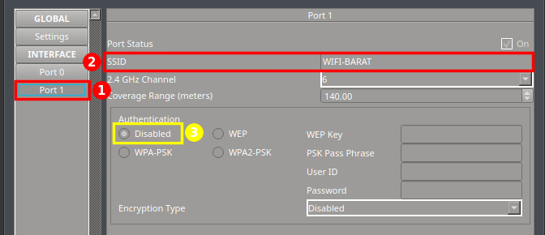

2. Klik smartphone wilayah yang sama → tab **Config** → ① **Wireless0** → ② isi SSID yang sama. ③ IP Configuration tetap **DHCP**; setelah tersambung ke AP yang benar, smartphone langsung mendapat IP dari subnet wilayahnya.

   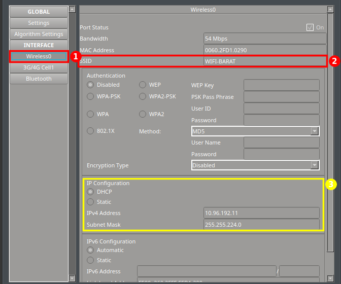

| Access Point | Smartphone | SSID |
| :--- | :--- | :--- |
| AP-WIFI-BARAT | HP-WIFI-BARAT | `WIFI-BARAT` |
| AP-WIFI-UTARA | HP-WIFI-UTARA | `WIFI-UTARA` |
| AP-WIFI-TIMUR | HP-WIFI-TIMUR | `WIFI-TIMUR` |
| AP-WIFI-SELATAN | HP-WIFI-SELATAN | `WIFI-SELATAN` |

#### Langkah 10 – Label topologi

Klik ① **Place Note** (atau tekan **N**) di toolbar, klik area kanvas, lalu tulis nama subnet, network ID/prefix, dan jumlah host. Total 23 label: 14 LAN, L1–L6, link ISP, server internet, dan tunnel GRE.

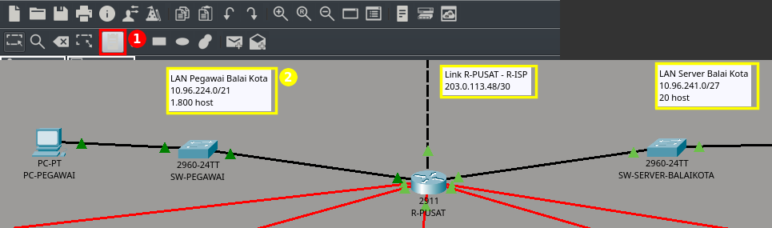

### Bukti dan Hasil

1. **Topologi lengkap**: lihat [gambar di bagian Ringkasan](#ringkasan-topologi--tabel-pengalamatan-ip). Backbone sama dengan Gambar 1 soal, semua perangkat sudah diganti namanya, dan setiap LAN berlabel.

2. **Semua interface R-PUSAT aktif**
   - **Node**: `R-PUSAT` → tab CLI → `show ip interface brief`

   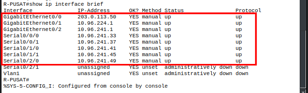
   *Ketiga port Gigabit dan kelima serial berstatus `up/up` dengan IP sesuai tabel. S0/2/1 sengaja `administratively down` karena cadangan.*

3. **Kabel tersambung ke port yang benar**
   - **Node**: `R-PUSAT` → `show cdp neighbors`

   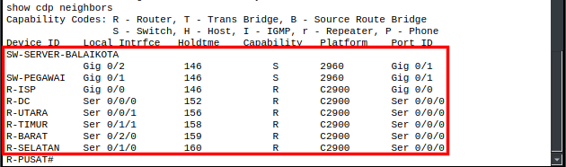
   *R-DC di Ser 0/0/0, R-UTARA di Ser 0/0/1, R-SELATAN di Ser 0/1/0, R-TIMUR di Ser 0/1/1, R-BARAT di Ser 0/2/0, R-ISP di Gig 0/0, dan dua switch LAN di Gig 0/1 dan Gig 0/2.*

4. **Sisi DCE dan clock rate benar** (`show controllers serial0/0/0`, `show controllers serial0/0/1`):
   ```
   R-PUSAT  Serial0/0/0 : DCE V.35, clock rate 64000
   R-PUSAT  Serial0/2/0 : DCE V.35, clock rate 64000
   R-UTARA  Serial0/0/1 : DCE V.35, clock rate 64000
   R-DC     Serial0/0/0 : DTE V.35 TX and RX clocks detected
   ```

5. **Pemeriksaan menyeluruh topologi**: tidak ada link yang mati (semua titik link hijau) dan tidak ada IP ganda. File `.pkt` berisi 36 kabel dan 23 label.

---

## Soal 2

>Dikerjakan Oleh Anggota C

### Soal
> Menggunakan VLSM dan CIDR, buat tabel di spreadsheet berisi nama subnet, network ID, prefix, rentang host, alamat broadcast, dan gateway untuk setiap subnet sesuai lembar jawaban UTS. Perbaikan dari UTS wajib dicatat di tabel revisi.

*(Menyusul: tabel VLSM, tabel CIDR, supernet per router, dan tabel revisi di file `.xlsx`.)*

---

## Soal 3

>Dikerjakan Oleh Zaki

### Soal
> Seluruh LAN dapat saling berkomunikasi hanya dengan static route (dan default route untuk arah keluar). Default route hanya boleh mengarah ke router di atasnya / keluar. R-PUSAT wajib punya static route ke semua LAN milik R-DC, R-UTARA, R-PELABUHAN, R-SELATAN, R-TIMUR, dan R-BARAT. R-UTARA wajib punya static route ke semua LAN milik R-PELABUHAN.

### Langkah Pengerjaan dan Implementasi

#### Konsep

- **Router wilayah (R-DC, R-BARAT, R-TIMUR, R-SELATAN) dan R-PELABUHAN adalah *stub***: hanya punya satu jalan keluar, yaitu router di atasnya. Semua tujuan selain LAN-nya sendiri cukup dikirim lewat **satu default route** ke atas.
- **R-UTARA** punya dua arah: ke atas (R-PUSAT) dan ke bawah (R-PELABUHAN). Default route ke atas, ditambah **2 static route** ke LAN Pelabuhan lewat L6.
- **R-PUSAT** adalah persimpangan. Default route-nya sudah dipakai ke ISP, jadi untuk 12 LAN di bawahnya harus ada **static route spesifik** (+1 rute ke link L6). Tanpa rute spesifik, paket ke LAN wilayah ikut default route ke ISP lalu dibuang. Karena *longest prefix match*, rute `/19`, `/24`, dst. selalu menang atas default `/0`.
- Rute ke link **L6 `10.96.241.52/30`** di R-PUSAT diperlukan agar alamat fisik R-PELABUHAN (`10.96.241.54`) bisa dicapai. Alamat ini nanti menjadi *tunnel destination* GRE (soal 6).
- **Next hop selalu IP router seberang** di link yang bersangkutan.
- **R-ISP sengaja tidak diberi rute** ke `10.96.0.0` (syarat soal 5).

Format perintah: `ip route <network tujuan> <subnet mask> <next hop>`

#### Langkah 1 – Static route di R-PUSAT

1. Buka CLI **R-PUSAT**, lalu masuk mode konfigurasi:
   ```
   enable
   configure terminal
   ```
2. Ketik 13 rute ke bawah, satu baris per jaringan tujuan:

   | Perintah | Tujuan | Lewat |
   | :--- | :--- | :--- |
   | `ip route 10.96.96.0 255.255.224.0 10.96.241.34` | LAN CCTV Kota | R-DC (L1) |
   | `ip route 10.96.239.0 255.255.255.0 10.96.241.34` | LAN Server & Storage DC | R-DC (L1) |
   | `ip route 10.96.0.0 255.255.192.0 10.96.241.38` | LAN WiFi Utara | R-UTARA (L2) |
   | `ip route 10.96.236.0 255.255.254.0 10.96.241.38` | LAN Sensor Lalin | R-UTARA (L2) |
   | `ip route 10.96.241.52 255.255.255.252 10.96.241.38` | link L6 | R-UTARA (L2) |
   | `ip route 10.96.160.0 255.255.224.0 10.96.241.38` | LAN SCADA Pelabuhan | R-UTARA (L2) → R-PELABUHAN |
   | `ip route 10.96.240.0 255.255.255.128 10.96.241.38` | LAN Kantor Pelabuhan | R-UTARA (L2) → R-PELABUHAN |
   | `ip route 10.96.64.0 255.255.224.0 10.96.241.42` | LAN WiFi Selatan | R-SELATAN (L3) |
   | `ip route 10.96.240.128 255.255.255.128 10.96.241.42` | LAN PJU Pintar | R-SELATAN (L3) |
   | `ip route 10.96.128.0 255.255.224.0 10.96.241.46` | LAN WiFi Timur | R-TIMUR (L4) |
   | `ip route 10.96.232.0 255.255.252.0 10.96.241.46` | LAN Sensor Banjir | R-TIMUR (L4) |
   | `ip route 10.96.192.0 255.255.224.0 10.96.241.50` | LAN WiFi Barat | R-BARAT (L5) |
   | `ip route 10.96.238.0 255.255.255.0 10.96.241.50` | LAN Puskesmas & Sekolah | R-BARAT (L5) |

3. Ketik default route ke internet:
   ```
   ip route 0.0.0.0 0.0.0.0 203.0.113.49
   ```
4. Simpan: `end` → `copy running-config startup-config` → Enter.

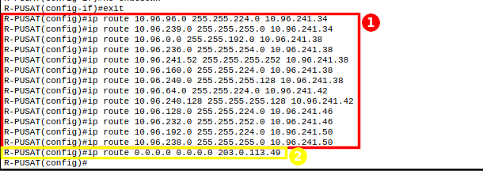
*① 13 static route ke bawah, ② default route ke R-ISP.*

#### Langkah 2 – Static route di R-UTARA

Buka CLI **R-UTARA** → `enable` → `configure terminal`, lalu ketik:

```
ip route 0.0.0.0 0.0.0.0 10.96.241.37
ip route 10.96.160.0 255.255.224.0 10.96.241.54
ip route 10.96.240.0 255.255.255.128 10.96.241.54
```

| Perintah | Fungsi |
| :--- | :--- |
| `ip route 0.0.0.0 0.0.0.0 10.96.241.37` | default route ke atas (R-PUSAT) |
| `ip route 10.96.160.0 255.255.224.0 10.96.241.54` | LAN SCADA lewat R-PELABUHAN |
| `ip route 10.96.240.0 255.255.255.128 10.96.241.54` | LAN Kantor Pelabuhan lewat R-PELABUHAN |

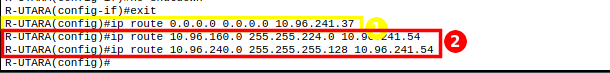
*① default route ke R-PUSAT, ② dua rute ke LAN Pelabuhan.*

Simpan: `end` → `copy running-config startup-config`.

#### Langkah 3 – Default route di router stub (contoh R-DC)

Buka CLI **R-DC** → `enable` → `configure terminal`, lalu ketik:

```
ip route 0.0.0.0 0.0.0.0 10.96.241.33
```

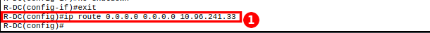

Router stub lainnya:

| Router | Perintah |
| :--- | :--- |
| R-SELATAN | `ip route 0.0.0.0 0.0.0.0 10.96.241.41` |
| R-TIMUR | `ip route 0.0.0.0 0.0.0.0 10.96.241.45` |
| R-BARAT | `ip route 0.0.0.0 0.0.0.0 10.96.241.49` |
| R-PELABUHAN | `ip route 0.0.0.0 0.0.0.0 10.96.241.53` (ke R-UTARA) |

Simpan setiap router: `end` → `copy running-config startup-config`.

> **Alternatif GUI:** tab **Config** → ① **Static** → ② isi Network, Mask, Next Hop → ③ **Add**. Daftar ④ berisi rute yang sudah terpasang.
>
> 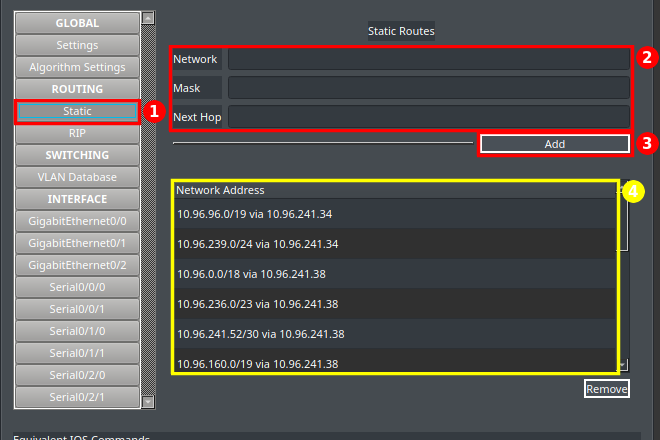

### Bukti dan Hasil

#### Tabel routing

1. **R-PUSAT** – `show ip route static`

   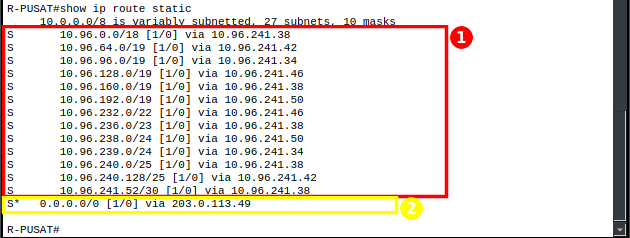
   *① 13 static route ke 12 LAN wilayah dan link L6, ② default route ke R-ISP `203.0.113.49`.*

2. **R-UTARA** – `show ip route static`

   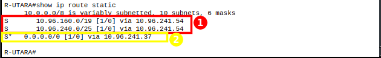
   *① rute ke LAN SCADA dan Kantor Pelabuhan lewat `10.96.241.54`, ② default ke atas `10.96.241.37`.*

3. **R-DC (router stub)** – `show ip route`

   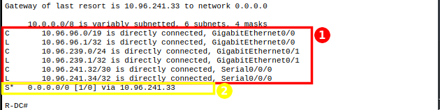
   *① hanya jaringan yang terhubung langsung, ② satu default route ke R-PUSAT `10.96.241.33`.*

#### Uji koneksi (Command Prompt, lihat [Panduan F](#f-membuka-command-prompt-pc--server--smartphone))

Pada setiap gambar: ① balasan `Reply from ...`, ② statistik `0% loss`.

| No | Dari | Ke | Jalur | Hasil |
| :---: | :--- | :--- | :--- | :---: |
| 1 | PC-CCTV-KOTA | Gateway sendiri `10.96.96.1` | dalam LAN | ✅ |
| 2 | PC-CCTV-KOTA | PC-KANTOR-PELABUHAN `10.96.240.11` | R-DC → R-PUSAT → R-UTARA → R-PELABUHAN | ✅ |
| 3 | PC-KANTOR-PELABUHAN | PC-PEGAWAI `10.96.224.11` | R-PELABUHAN → R-UTARA → R-PUSAT | ✅ |
| 4 | PC-KANTOR-PELABUHAN | SRV-DC `10.96.239.2` | R-PELABUHAN → R-UTARA → R-PUSAT → R-DC | ✅ |
| 5 | PC-PJU | PC-SENSOR-LALIN `10.96.236.11` | R-SELATAN → R-PUSAT → R-UTARA | ✅ |
| 6 | HP-WIFI-BARAT (wireless) | SRV-BALAIKOTA `10.96.241.2` | AP → R-BARAT → R-PUSAT | ✅ |

**Uji 1** – PC-CCTV-KOTA → `ping 10.96.96.1`

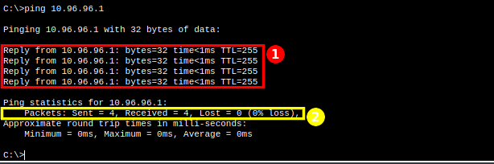

**Uji 2** – PC-CCTV-KOTA → `ping 10.96.240.11` (jalur terjauh)


*TTL 124 = 128 − 4: paket melewati 4 router.*

**Uji 3** – PC-KANTOR-PELABUHAN → `ping 10.96.224.11`

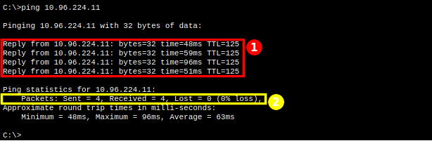

**Uji 4** – PC-KANTOR-PELABUHAN → `ping 10.96.239.2`

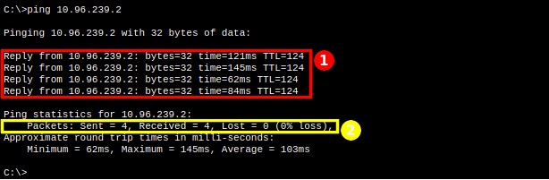

**Uji 5** – PC-PJU → `ping 10.96.236.11`

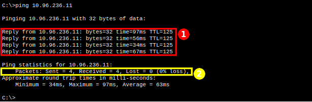

**Uji 6** – HP-WIFI-BARAT → `ping 10.96.241.2`

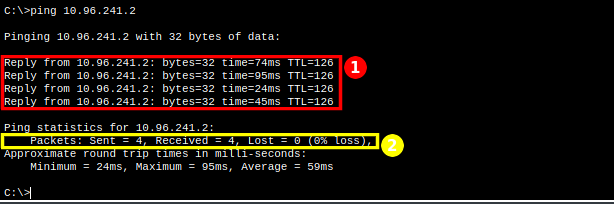

**Uji 7** – PC-CCTV-KOTA → `tracert 10.96.240.11` (melihat router yang dilewati)

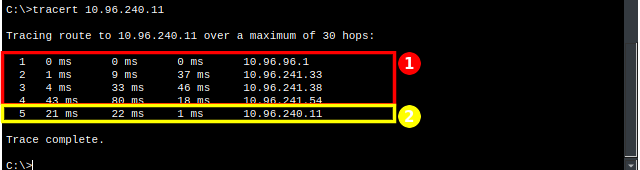
*① R-DC (`10.96.96.1`) → R-PUSAT (`10.96.241.33`) → R-UTARA (`10.96.241.38`) → R-PELABUHAN (`10.96.241.54`), ② tujuan `10.96.240.11`.*

**Rekap uji ping ke seluruh gateway LAN** (ping 4 paket dari kedua ujung jaringan):

| Dari | Ke 14 gateway LAN | Hasil |
| :--- | :--- | :---: |
| PC-CCTV-KOTA (R-DC) | `10.96.0.1`, `10.96.64.1`, `10.96.96.1`, `10.96.128.1`, `10.96.160.1`, `10.96.192.1`, `10.96.224.1`, `10.96.232.1`, `10.96.236.1`, `10.96.238.1`, `10.96.239.1`, `10.96.240.1`, `10.96.240.129`, `10.96.241.1` | **14/14** ✅ |
| PC-KANTOR-PELABUHAN (R-PELABUHAN) | 14 gateway yang sama | **14/14** ✅ |

*Ping pertama kadang kehilangan 1 paket karena ARP; ulangi sekali bila muncul `Request timed out` di paket pertama.*

---

## Soal 4

>Dikerjakan Oleh Zaki

### Soal
> Interface router dan seluruh server menggunakan IP statis. Perangkat pengguna mendapat IP dinamis secara otomatis, lengkap dengan gateway dan DNS server, tanpa bentrok dengan alamat IP statis. Khusus subnet CCTV Kota (subnet R-DC) mendapatkan alamat dari server DHCP di LAN Server dan Storage DC, bukan dari router.

### Langkah Pengerjaan dan Implementasi

#### Langkah 1 – IP statis server

1. Klik **SRV-DC** → tab ① **Desktop** → **IP Configuration**.
2. Pilih ② **Static**.
3. ③ Isi IPv4 Address `10.96.239.2`, Subnet Mask `255.255.255.0`, Default Gateway `10.96.239.1`, DNS Server `10.96.239.2`.

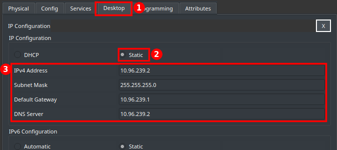

Lakukan juga untuk **SRV-BALAIKOTA**: `10.96.241.2`, `255.255.255.224`, gateway `10.96.241.1`, DNS `10.96.239.2`.

#### Langkah 2 – DHCP pool di R-PUSAT (LAN Pegawai)

1. Buka CLI **R-PUSAT** → `enable` → `configure terminal`.
2. Kecualikan alamat statis agar tidak dibagikan DHCP:
   ```
   ip dhcp excluded-address 10.96.224.1 10.96.224.10
   ```
3. Buat pool, lalu isi jaringan, gateway, dan DNS-nya:
   ```
   ip dhcp pool DHCP-PEGAWAI
   network 10.96.224.0 255.255.248.0
   default-router 10.96.224.1
   dns-server 10.96.239.2
   exit
   ```
4. Simpan: `end` → `copy running-config startup-config`.

| Perintah | Fungsi | Prompt setelahnya |
| :--- | :--- | :--- |
| `ip dhcp excluded-address 10.96.224.1 10.96.224.10` | `.1`–`.10` tidak pernah dibagikan (gateway, server, cadangan) | `(config)#` |
| `ip dhcp pool DHCP-PEGAWAI` | membuat pool bernama DHCP-PEGAWAI | `(dhcp-config)#` |
| `network 10.96.224.0 255.255.248.0` | jaringan yang dilayani pool ini | `(dhcp-config)#` |
| `default-router 10.96.224.1` | gateway yang diberikan ke klien | `(dhcp-config)#` |
| `dns-server 10.96.239.2` | DNS yang diberikan ke klien (SRV-DC) | `(dhcp-config)#` |
| `exit` | keluar dari pool | `(config)#` |

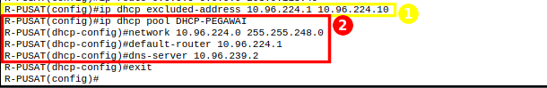
*① excluded-address, ② pool DHCP-PEGAWAI.*

#### Langkah 3 – DHCP pool di router wilayah (contoh R-UTARA, 2 pool)

Router dengan dua LAN pengguna membuat dua pool. Buka CLI **R-UTARA** → `enable` → `configure terminal`, lalu ketik:

```
ip dhcp excluded-address 10.96.0.1 10.96.0.10
ip dhcp pool DHCP-WIFI-UTARA
network 10.96.0.0 255.255.192.0
default-router 10.96.0.1
dns-server 10.96.239.2
exit
ip dhcp excluded-address 10.96.236.1 10.96.236.10
ip dhcp pool DHCP-SENSOR-LALIN
network 10.96.236.0 255.255.254.0
default-router 10.96.236.1
dns-server 10.96.239.2
exit
```

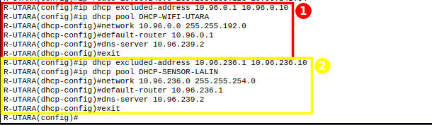
*① pool WiFi Utara, ② pool Sensor Lalu Lintas.*

Router lain memakai pola yang sama (DNS selalu `10.96.239.2`):

| Router | `ip dhcp excluded-address` | `ip dhcp pool` | `network` | `default-router` |
| :--- | :--- | :--- | :--- | :--- |
| R-BARAT | `10.96.192.1 10.96.192.10` | `DHCP-WIFI-BARAT` | `10.96.192.0 255.255.224.0` | `10.96.192.1` |
| R-BARAT | `10.96.238.1 10.96.238.10` | `DHCP-PUSKESMAS` | `10.96.238.0 255.255.255.0` | `10.96.238.1` |
| R-TIMUR | `10.96.128.1 10.96.128.10` | `DHCP-WIFI-TIMUR` | `10.96.128.0 255.255.224.0` | `10.96.128.1` |
| R-TIMUR | `10.96.232.1 10.96.232.10` | `DHCP-SENSOR-BANJIR` | `10.96.232.0 255.255.252.0` | `10.96.232.1` |
| R-SELATAN | `10.96.64.1 10.96.64.10` | `DHCP-WIFI-SELATAN` | `10.96.64.0 255.255.224.0` | `10.96.64.1` |
| R-SELATAN | `10.96.240.129 10.96.240.138` | `DHCP-PJU` | `10.96.240.128 255.255.255.128` | `10.96.240.129` |
| R-PELABUHAN | `10.96.160.1 10.96.160.10` | `DHCP-SCADA` | `10.96.160.0 255.255.224.0` | `10.96.160.1` |
| R-PELABUHAN | `10.96.240.1 10.96.240.10` | `DHCP-KANTOR-PELABUHAN` | `10.96.240.0 255.255.255.128` | `10.96.240.1` |

LAN Server Balai Kota dan LAN Server & Storage DC **tidak diberi pool** karena isinya server ber-IP statis. LAN CCTV juga **tidak** diberi pool di router (lihat langkah 4).

#### Langkah 4 – DHCP LAN CCTV dari SRV-DC (DHCP relay)

LAN CCTV (`10.96.96.0/19`) dan SRV-DC (`10.96.239.0/24`) berbeda subnet. Broadcast DHCP tidak bisa menyeberang router, jadi **R-DC dijadikan DHCP relay**: permintaan DHCP dari LAN CCTV diteruskan sebagai unicast ke SRV-DC.

**4.1 Relay di R-DC.** Buka CLI **R-DC** → `enable` → `configure terminal`, lalu ketik pada interface yang menghadap LAN CCTV:

```
interface g0/0
ip helper-address 10.96.239.2
```

Simpan: `end` → `copy running-config startup-config`.

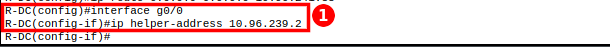
*① `ip helper-address` di G0/0 (gateway LAN CCTV) menunjuk ke SRV-DC.*

**4.2 Pool di SRV-DC.**
1. Klik **SRV-DC** → tab ① **Services** → ② **DHCP**.
2. ③ Service **On**.
3. ④ Isi Pool Name `DHCP-CCTV`, Default Gateway `10.96.96.1`, DNS Server `10.96.239.2`, Start IP Address `10.96.96.11`, Subnet Mask `255.255.224.0`, Maximum Number of Users `8180`.
4. ⑤ Klik **Add** (atau **Save** bila mengedit). Pool tampil di tabel ⑥.
5. Pool bawaan `serverPool` dihapus (pilih → **Remove**) agar server tidak membagikan alamat lain.

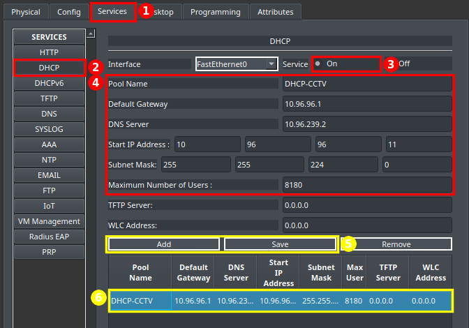

#### Langkah 5 – Host pengguna memakai DHCP

1. Klik PC → tab ① **Desktop** → **IP Configuration**.
2. Pilih ② **DHCP**.
3. Tunggu beberapa detik sampai ③ IP, mask, gateway, dan DNS terisi otomatis.

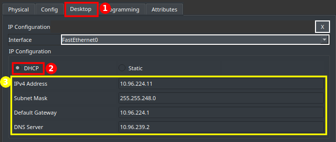

Smartphone sudah memakai DHCP secara bawaan (Config → Wireless0 → IP Configuration **DHCP**, lihat soal 1 langkah 9).

### Bukti dan Hasil

1. **Relay CCTV bekerja** – PC-CCTV-KOTA → `ipconfig /all`

   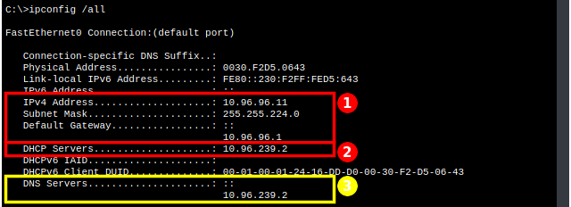
   *① IP `10.96.96.11/19` dan gateway `10.96.96.1`, ② **DHCP Servers `10.96.239.2`**: alamat diberikan oleh SRV-DC lewat relay, bukan oleh R-DC, ③ DNS `10.96.239.2`.*

2. **Helper-address tersimpan di R-DC** – `show running-config | include helper`

   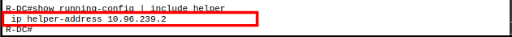

3. **Minta ulang IP dari DHCP (PC kabel)** – PC-SENSOR-BANJIR → `ipconfig /renew`

   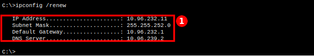
   *① IP `10.96.232.11` (di luar `.1`–`.10`), gateway `10.96.232.1`, DNS `10.96.239.2` dari R-TIMUR.*

4. **Minta ulang IP dari DHCP (smartphone wireless)** – HP-WIFI-TIMUR → `ipconfig /renew`

   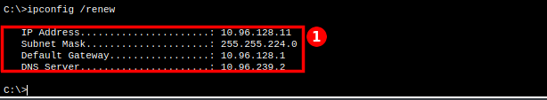
   *① HP mendapat IP dari subnet WiFi Timur, membuktikan HP tersambung ke AP yang benar (SSID `WIFI-TIMUR`).*

5. **Lease DHCP di router** – R-UTARA → `show ip dhcp binding`

   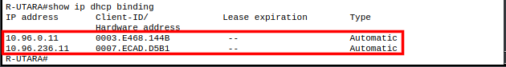
   *HP-WIFI-UTARA mendapat `10.96.0.11`, PC-SENSOR-LALIN `10.96.236.11`.*

6. **Rekap seluruh host DHCP** (diambil dari `ipconfig /all` di setiap host):

   | Host | IP | Gateway | DNS | DHCP Server |
   | :--- | :--- | :--- | :--- | :--- |
   | PC-PEGAWAI | `10.96.224.11` | `10.96.224.1` | `10.96.239.2` | `10.96.224.1` (R-PUSAT) |
   | PC-CCTV-KOTA | `10.96.96.11` | `10.96.96.1` | `10.96.239.2` | **`10.96.239.2` (SRV-DC, relay)** |
   | PC-PUSKESMAS | `10.96.238.12` | `10.96.238.1` | `10.96.239.2` | `10.96.238.1` (R-BARAT) |
   | PC-SENSOR-LALIN | `10.96.236.11` | `10.96.236.1` | `10.96.239.2` | `10.96.236.1` (R-UTARA) |
   | PC-SENSOR-BANJIR | `10.96.232.11` | `10.96.232.1` | `10.96.239.2` | `10.96.232.1` (R-TIMUR) |
   | PC-PJU | `10.96.240.140` | `10.96.240.129` | `10.96.239.2` | `10.96.240.129` (R-SELATAN) |
   | PC-SCADA | `10.96.160.12` | `10.96.160.1` | `10.96.239.2` | `10.96.160.1` (R-PELABUHAN) |
   | PC-KANTOR-PELABUHAN | `10.96.240.11` | `10.96.240.1` | `10.96.239.2` | `10.96.240.1` (R-PELABUHAN) |
   | HP-WIFI-BARAT | `10.96.192.11` | `10.96.192.1` | `10.96.239.2` | `10.96.192.1` (R-BARAT) |
   | HP-WIFI-UTARA | `10.96.0.11` | `10.96.0.1` | `10.96.239.2` | `10.96.0.1` (R-UTARA) |
   | HP-WIFI-TIMUR | `10.96.128.11` | `10.96.128.1` | `10.96.239.2` | `10.96.128.1` (R-TIMUR) |
   | HP-WIFI-SELATAN | `10.96.64.11` | `10.96.64.1` | `10.96.239.2` | `10.96.64.1` (R-SELATAN) |

   *Ke-12 host mendapat IP di subnet yang benar, di luar rentang statis `.1`–`.10`, lengkap dengan gateway (host pertama) dan DNS `10.96.239.2`.*

---

## Soal 5

>Dikerjakan Oleh Zaki

### Soal
> Seluruh host dapat mengakses server 8.8.8.8 menggunakan satu IP publik milik R-PUSAT. R-ISP tidak boleh memiliki rute ke alamat privat internal.

### Langkah Pengerjaan dan Implementasi

#### Konsep

Tanpa NAT, paket dari PC sampai ke 8.8.8.8, tetapi balasannya ke alamat `10.96.x.x` dibuang di R-ISP karena R-ISP tidak punya rute ke alamat privat. Solusinya **PAT (NAT overload)** di R-PUSAT: semua alamat `10.96.0.0/16` diterjemahkan ke satu IP publik `203.0.113.50` (G0/0), dibedakan dengan nomor port.

- **inside** = semua interface R-PUSAT yang menghadap jaringan internal (2 LAN + 5 serial).
- **outside** = interface ke ISP (G0/0).
- R-ISP **tidak diubah sama sekali**.

#### Langkah 1 – Buka CLI R-PUSAT dan masuk mode konfigurasi

```
enable
configure terminal
```

#### Langkah 2 – Tentukan alamat yang boleh di-NAT

```
access-list 1 permit 10.96.0.0 0.0.255.255
```

Wildcard `0.0.255.255` mencocokkan seluruh `10.96.0.0/16` dalam satu baris.

#### Langkah 3 – Tandai interface inside

Masuk ke setiap interface yang menghadap jaringan internal dan ketik `ip nat inside`:

```
interface g0/1
ip nat inside
interface g0/2
ip nat inside
interface s0/0/0
ip nat inside
interface s0/0/1
ip nat inside
interface s0/1/0
ip nat inside
interface s0/1/1
ip nat inside
interface s0/2/0
ip nat inside
```

| Interface | Menghadap |
| :--- | :--- |
| `g0/1` | LAN Pegawai Balai Kota |
| `g0/2` | LAN Server Balai Kota |
| `s0/0/0` | L1 → R-DC |
| `s0/0/1` | L2 → R-UTARA (termasuk R-PELABUHAN) |
| `s0/1/0` | L3 → R-SELATAN |
| `s0/1/1` | L4 → R-TIMUR |
| `s0/2/0` | L5 → R-BARAT |

#### Langkah 4 – Tandai interface outside

```
interface g0/0
ip nat outside
exit
```

#### Langkah 5 – Aktifkan PAT

```
ip nat inside source list 1 interface g0/0 overload
```

Artinya: alamat yang cocok dengan `access-list 1` diterjemahkan ke IP milik `g0/0`, dan `overload` membuat banyak host berbagi satu IP itu dengan nomor port berbeda.

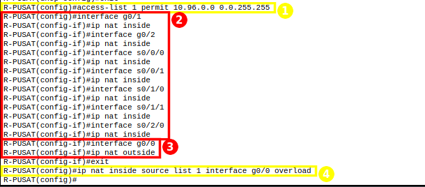
*① access-list, ② tujuh interface inside, ③ G0/0 outside, ④ PAT overload.*

#### Langkah 6 – Simpan

`end` → `copy running-config startup-config` → Enter.

### Bukti dan Hasil

1. **Konfigurasi NAT tersimpan** – R-PUSAT → `show running-config | include nat`

   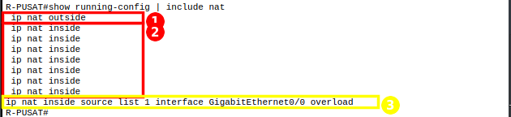
   *① G0/0 outside, ② tujuh interface inside, ③ PAT `overload` memakai IP G0/0.*

2. **Host internal bisa mengakses 8.8.8.8** (setiap gambar: ① balasan dari 8.8.8.8, ② `0% loss`)

   **Uji 1** – PC-PEGAWAI (LAN Balai Kota) → `ping 8.8.8.8`

   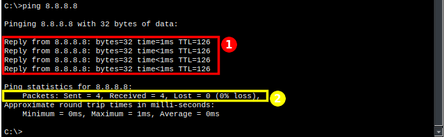

   **Uji 2** – PC-CCTV-KOTA (LAN R-DC) → `ping 8.8.8.8`

   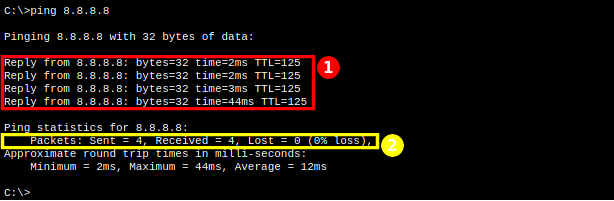

   **Uji 3** – PC-KANTOR-PELABUHAN (LAN terjauh, lewat R-UTARA) → `ping 8.8.8.8`

   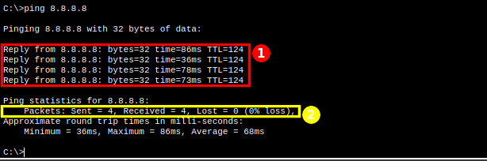

   **Uji 4** – HP-WIFI-SELATAN (wireless) → `ping 8.8.8.8`

   

3. **Tabel translasi NAT** – R-PUSAT → `show ip nat translations` (setelah ping dari PC-SCADA dan HP-WIFI-TIMUR)

   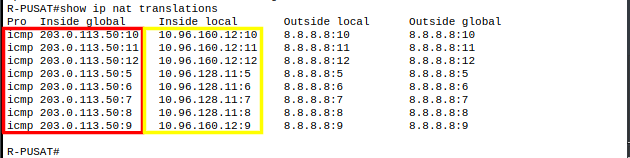
   *Kolom merah (Inside global) = satu IP publik `203.0.113.50` dengan port berbeda; kolom kuning (Inside local) = alamat privat asli `10.96.160.12` (PC-SCADA) dan `10.96.128.11` (HP-WIFI-TIMUR).*

4. **R-ISP tidak punya rute ke alamat privat** – R-ISP → `show ip route`

   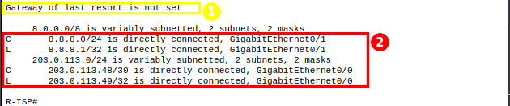
   *① tidak ada default route, ② hanya `8.8.8.0/24` dan `203.0.113.48/30`, tidak ada `10.96.x.x`.*

5. **Uji negatif: internet tidak bisa menjangkau alamat privat** – SRV-INTERNET → `ping 10.96.224.11`

   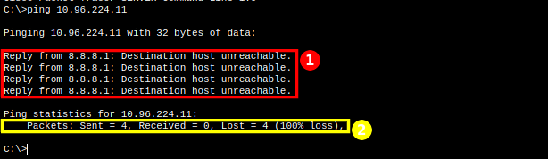
   *① R-ISP (`8.8.8.1`) membalas `Destination host unreachable` karena tidak punya rute ke `10.96.0.0`, ② 100% loss. Hasil ini **memang seharusnya gagal**: jaringan internal tidak terekspos ke internet.*

6. **Rekap uji akses internet** (ping 4 paket ke `8.8.8.8`):

   | Sumber | Hasil | | Sumber | Hasil |
   | :--- | :---: | :--- | :--- | :---: |
   | PC-PEGAWAI | ✅ | | HP-WIFI-BARAT | ✅ |
   | PC-CCTV-KOTA | ✅ | | HP-WIFI-UTARA | ✅ |
   | PC-PUSKESMAS | ✅ | | HP-WIFI-TIMUR | ✅ |
   | PC-SENSOR-LALIN | ✅ | | HP-WIFI-SELATAN | ✅ |
   | PC-SENSOR-BANJIR | ✅ | | SRV-DC | ✅ |
   | PC-PJU | ✅ | | SRV-BALAIKOTA | ✅ |
   | PC-SCADA | ✅ | | | |
   | PC-KANTOR-PELABUHAN | ✅ | | **Total** | **14/14** |

---

## Soal 6

>Dikerjakan Oleh 

### Soal
> Bangun tunnel GRE antara R-PUSAT dan R-PELABUHAN. Lalu lintas antara subnet Balai Kota dan subnet Pelabuhan harus melewati tunnel. Jelaskan mengapa router memilih jalur tunnel dan mengapa GRE saja tidak mengenkripsi data. Bonus (+5): enkripsi IPsec.

### Sebelum tunnel
Dari `PC-PEGAWAI`, hasilnya lewat `R-UTARA`


### Buat tunnel di `R-PUSAT`


| Perintah | Arti |
| :--- | :--- |
| `interface Tunnel0` | membuat interface virtual |
| `ip address 192.168.12.1 ...` | IP tunnel |
| `tunnel source Serial0/0/1` | ujung tunnel di sisi ini, port ke R-UTARA (10.96.241.37) |
| `tunnel destination 10.96.241.54` | ujung tunnel di seberang, alamat fisik R-PELABUHAN |
| `tunnel mode gre ip` | jenis tunnel GRE |

### Buat tunnel di `R-PELABUHAN`


Alamat sumber dan tujuannya dibalik. 

### Cek tunnel sudah hidup


### Paksa trafic lewat tunnel (`R-PUSAT`)
Sudah ada dua jalan ke pelabuhan (utara dan tunnel). Route lama harus dilewati tetapi disimpan sebagai cadangan. 


- `no ip route` menghapus route lama.
- dua bars berikutnya membuat route baru lewat tunnel dengan AD 1 (bawaan static route).
- dua baris terakhir memasang kembali route lama dengan AD 200, hanya jadi cadangan.

### Atur arah balik (`R-PELABUHAN`)


Route ini untuk dua subnet Balai Kota: Pegawai (`10.96.224.0/21`) dan Server Balai Kota (`10.96.241.0/27`). Route ini lebih spesifik daripada default route, jadi yang dipilih adalah route tunnel.

### Uji coba
`Tunnel0` dan `line protocol` bernilai `is up` pada `R-PUSAT` dan `R-PELABUHAN`


dua route pelabuhan lewat `192.168.12.2` pada `R-PUSAT`


route balai kota lewat `192.168.12.1` pada `R-PELABUHAN`


tracert dan ping pada `PC-PEGAWAI`


ping pada `PC-KANTOR-PELABUHAN`


ping pada `PC-SCADA`


### Router memilih jalur tunnel
Di `R-PUSAT` ada dua route ke LAN Pelabuhan dengan prefix yang sama: satu lewat `Tunnel0` (`192.168.12.2`, AD 1) dan satu lewat `R-UTARA` (`10.96.241.38`, AD 200). Router memilih route dengan Administrative Distance **terkecil**, jadi **jalur tunnel yang dipakai**. Route lewat `R-UTARA` tetap ada di konfigurasi sebagai cadangan. Di `R-PELABUHAN`, route ke subnet Balai Kota lewat tunnel dipilih karena lebih spesifik (`/21` dan `/27`) daripada default route `0.0.0.0/0` ke `R-UTARA`, sesuai aturan longest prefix match.

## Soal 7

>Dikerjakan Oleh Anggota B

### Soal
> Kerjakan di file terpisah. Tambahkan link cadangan L7 antara R-DC dan R-UTARA dengan alamat yang belum digunakan. Ganti seluruh static route antar-router dengan OSPF: router tidak mengirim pesan OSPF ke LAN pengguna, default route hanya dikonfigurasi di R-PUSAT dan disebarkan lewat OSPF, dan konektivitas pulih otomatis jika satu link backbone putus.

*(Menyusul.)* Catatan dari bagian A: L7 memakai `10.96.241.56/30`. R-DC masih punya `S0/0/1` kosong; R-UTARA perlu 1 modul HWIC-2T tambahan di slot 0/1 (`S0/1/0`).

---

## Soal 8

>Dikerjakan Oleh Anggota B

### Soal
> Gunakan domain internal `k12.smartcity.lab`. DNS di LAN Server dan Storage DC, Web "Portal Smart City Surabaya" di LAN Server Balai Kota, FTP di LAN Server dan Storage DC dengan akun login (CCTV dapat upload), serta email antarpegawai Balai Kota dan Pelabuhan.

*(Menyusul.)* Catatan dari bagian A: SRV-DC `10.96.239.2` (DNS, FTP) dan SRV-BALAIKOTA `10.96.241.2` (Web) sudah ber-IP statis. DHCP semua host sudah membagikan DNS `10.96.239.2`, jadi cukup aktifkan layanan DNS di SRV-DC.

---

## Kendala & Solusi

| Kendala | Penyebab | Solusi |
| :--- | :--- | :--- |
| Router-PT tidak bisa membuat GRE/IPsec | IOS 12.2 PT1000 tidak punya `interface Tunnel`; `crypto ?` hanya berisi `key` | Semua router diganti **Cisco 2911** + HWIC-2T sesuai modul |
| HP WiFi tersambung ke AP wilayah lain | Semua AP memakai SSID bawaan `Default` | SSID unik per wilayah di AP dan smartphone |
| Setelah router diganti, PC tidak bisa ping gateway | Cache ARP PC masih menyimpan MAC router lama | Tunggu ARP kedaluwarsa, atau ping PC dari router sekali |
| Perintah `show` ditolak di CLI (`% Invalid input`) | Mengklik interface di tab Config membuat console masuk mode `(config-if)#` | Ketik `end` dulu |
| `enable` / `configure terminal` ditolak | Console masih di mode `(config-if)#` atau `(config)#` | Ketik `end`, lalu ulangi |
| Ping pertama `Request timed out` | Proses ARP pada paket pertama | Ulangi ping |
| Salah ketik perintah membuat CLI "macet" | Router mencoba DNS lookup nama perintah | `no ip domain-lookup` di semua router |
| Serial `up/down` | Clock rate belum diset di sisi DCE | `clock rate 64000` di router atas; cek dengan `show controllers` |
